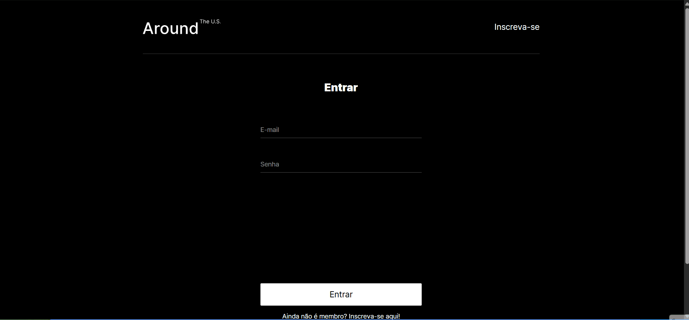

# 🌍 Around The U.S. - Full Stack


## 📋 Sobre o Projeto

O **Around The U.S.** é uma aplicação web Full Stack onde os usuários podem compartilhar e explorar seus lugares favoritos pelo mundo. Este projeto foi desenvolvido como requisito final do bootcamp de Desenvolvimento Web, unindo um front-end moderno em React a um back-end robusto em Node.js, com persistência de dados em MongoDB.

### 🔗 Links do Projeto

- **🌐 Site em Produção (Vercel):** [Clique aqui para acessar](https://web-project-api-full-lake.vercel.app/)
- **⚙️ API Backend (Render):** [Clique aqui para acessar](https://around-api-full.onrender.com)

> **Nota:** Como o backend está hospedado no plano gratuito da Render, a primeira requisição ao entrar no site pode levar até 50 segundos para responder (Cold Start). As requisições seguintes serão instantâneas.

---

## 📸 Demonstração



## 🚀 Funcionalidades

- **Autenticação de Usuário:** Cadastro e login seguros utilizando **JWT (JSON Web Tokens)**. As senhas são criptografadas no banco de dados usando `bcryptjs`.
- **Gerenciamento de Perfil:** O usuário pode atualizar seu nome, descrição ("about") e foto de perfil.
- **Galeria Dinâmica:** Criação e exibição de cartões contendo o nome do local e uma imagem.
- **Interação:** Sistema de curtir/descurtir cartões. Os cartões curtidos pelo usuário logado são destacados visualmente.
- **Segurança e Permissões:** O usuário só pode deletar os cartões que ele mesmo criou (validação feita via backend) e o botão de excluir só aparece nos seus próprios cartões.
- **Validação de Dados:** Uso da biblioteca **Celebrate (Joi)** para garantir que os dados enviados à API estejam no formato correto.
- **Feedback ao Usuário:** Mensagens de erro da API exibidas na interface e botões de envio desabilitados enquanto a requisição está em andamento.
- **Tratamento de Erros e Logs:** Middleware centralizado de erros e logs de requisições/erros usando **Winston** (gerando arquivos `request.log` e `error.log`).

---

## 🛠️ Tecnologias Utilizadas

### Front-end

- **React** (com Hooks e Context API)
- **Vite** (Build tool)
- **React Router DOM** (Navegação e rotas protegidas)
- **CSS3** (Metodologia BEM)

### Back-end

- **Node.js** e **Express.js**
- **MongoDB** e **Mongoose** (Modelagem de dados)
- **JWT** e **bcryptjs** (Autenticação e segurança)
- **Celebrate** (Validação de rotas)
- **Winston** e **Express-Winston** (Logs)

---

## 📁 Estrutura do Repositório

```text
web_project_api_full/
├── backend/         # API Node.js/Express e conexão com MongoDB
└── frontend/        # Aplicação React/Vite
```

---

## ⚙️ Configuração

### Backend (`backend/.env`)

Use o arquivo `backend/.env.example` como modelo.

| Variável          | Descrição                                                              | Padrão                                |
| ----------------- | ---------------------------------------------------------------------- | ------------------------------------- |
| `NODE_ENV`        | `production` em produção                                               | —                                     |
| `PORT`            | Porta do servidor                                                      | `3000`                                |
| `MONGODB_URI`     | String de conexão do MongoDB                                           | `mongodb://localhost:27017/aroundb`   |
| `JWT_SECRET`      | Segredo usado para assinar/verificar o JWT (**obrigatório em produção**) | valor de desenvolvimento (só fora de produção) |
| `ALLOWED_ORIGINS` | Origens permitidas pelo CORS, separadas por vírgula                    | `localhost:5173` (dev) / site da Vercel (prod) |

> Gere um segredo forte com: `node -e "console.log(require('crypto').randomBytes(48).toString('hex'))"`

### Frontend (`frontend/.env`)

| Variável       | Descrição        | Padrão                                |
| -------------- | ---------------- | ------------------------------------- |
| `VITE_API_URL` | URL base da API  | `https://around-api-full.onrender.com` |

---

## 💻 Como Executar Localmente

```bash
# Backend
cd backend
cp .env.example .env
npm install
npm run dev

# Frontend (em outro terminal)
cd frontend
npm install
npm run dev
```

O servidor só começa a escutar requisições depois de conectar ao MongoDB.

---

## 🔌 Rotas da API

| Método | Rota                | Auth | Descrição                          |
| ------ | ------------------- | ---- | ---------------------------------- |
| POST   | `/signup`           | Não  | Cadastro de usuário                |
| POST   | `/signin`           | Não  | Login (retorna o token JWT)        |
| GET    | `/users/me`         | Sim  | Dados do usuário logado            |
| PATCH  | `/users/me`         | Sim  | Atualiza nome e "sobre" (máx. 30 caracteres cada) |
| PATCH  | `/users/me/avatar`  | Sim  | Atualiza a foto de perfil          |
| GET    | `/cards`            | Sim  | Lista os cartões                   |
| POST   | `/cards`            | Sim  | Cria um cartão                     |
| DELETE | `/cards/:cardId`    | Sim  | Exclui um cartão (apenas o dono)   |
| PUT    | `/cards/:cardId/likes` | Sim | Curte um cartão                 |
| DELETE | `/cards/:cardId/likes` | Sim | Remove a curtida                |

---

## 🔒 Segurança

- Nunca versione o arquivo `.env`, os logs (`request.log`, `error.log`) ou a pasta `node_modules` — mantenha-os no `.gitignore`.
- O segredo do JWT vem de `JWT_SECRET`; se ele já esteve no código de um repositório público, troque-o por um novo.
- O CORS aceita apenas as origens listadas em `ALLOWED_ORIGINS`.
